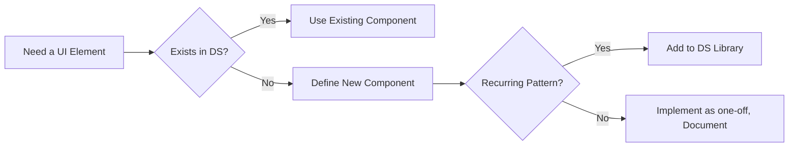

# Design-Intelligence Layer for UI Design

**Executive Summary:** This report compiles best practices and decision frameworks for building a design-intelligence layer to drive an AI-powered UI design system. It covers all key tracks (with emphasis on motion, asset sourcing, design systems, and color) and provides clear rules, flowcharts, metrics, checklists, trade-offs, failure modes, and implementation constraints. For each track (Color, Typography, Layout, Motion, Accessibility, Design Systems, UX Writing, Aesthetics/Branding, Performance, Evaluation, Asset Sourcing, Implementation Constraints), we summarize guidelines from primary sources and cite them. We also list open licenses for recommended assets and examine offline feasibility (strict CSP, self-hosting). Tables compare major options (e.g. icon libraries, image sources) and JSON/YAML snippets capture structured rules. Finally, we present a research timeline. All claims are source-cited for traceability.

## Color

Good color choice balances aesthetics, meaning, and accessibility. Follow WCAG contrast ratios: **minimum 4.5:1 for normal text, 3:1 for large text**. For non-text UI elements (e.g. button backgrounds), use ≥3:1 against adjacent colors. Design tokens (CSS custom properties) are recommended for theming. Always test colorblindness; avoid problematic combos (e.g. red/green without labels). A safe palette uses varying lightness and hues distinct in intensity (e.g. blue+orange). Never rely on color alone to convey information. 

- **Decision Rules:** Use semantic color roles (primary, success, warning, error) with high contrast. If a user has `prefers-color-scheme: dark`, switch to a dark palette (dark grays instead of pure black) with equal contrast.  
- **Checklist:** 
  - Contrast check (use WebAIM Color Contrast Checker or browser tools). 
  - Colorblind simulator test (e.g. [WhoCanUse.com]). 
  - Brand compliance: ensure main brand color meets contrast on both light/dark backgrounds. 
  - Alt text for colored charts. 
- **Trade-offs:** Saturated bright colors increase attention but can cause strain or clash with dark mode; pastel tones are easier on eyes but risk low contrast. High contrast improves readability but may affect aesthetics.  
- **Failure Mode / Mitigation:** Low contrast causes illegibility (fix by adjusting brightness or using larger fonts). Overuse of red/green confuses colorblind users (mitigate by adding shapes or patterns, or avoid that pair altogether).  
- **Implementation:** Define a color token JSON or CSS file. Example token snippet: 

```json
{
  "colors": {
    "brandPrimary": "#3366FF",
    "bgLight": "#FFFFFF",
    "bgDark": "#121212",
    "textOnLight": "#222222",
    "textOnDark": "#EEEEEE",
    "error": "#D32F2F",
    "success": "#388E3C",
    "contrastAA": 4.5
  }
}
```

- **Thresholds/Metrics:** WCAG 2.1 (AA) contrast as above. For animation flashes, limit to ≤3 per second.  
- **Decision Tree (Color Scheme Selection):** 

```mermaid
flowchart TD
  A[Choose Base Theme] --> B{User or Brand Preference}
  B -->|Dark| C[Use Dark Palette (near-black background, light text)]
  B -->|Light| D[Use Light Palette (white background, dark text)]
  C --> E{High Contrast Required?}
  D --> E
  E -->|Yes| F[Use high-contrast color pairs (e.g. #FFF/#000)]
  E -->|No| G[Use brand hues with sufficient contrast]
```

**Sources:** WCAG contrast rules; colorblind guidelines; dark mode advice.

## Typography

Typography must prioritize readability and consistency. Use at most 2–3 fonts (one for headings, one for body, optional accent). Base font size ≈16px (1rem) for body on desktop. Line height should be **≥1.5× font size** for normal text. Optimal line length is **50–75 characters per line** (including spaces) to maximize readability. Use em/rem units for scalability; avoid fixed px sizing that breaks zooming. 

- **Rules:**  
  - **Line length:** 50–75 characters.  
  - **Line height:** ≥1.5 (150%).  
  - **Font weight & size hierarchy:** Body ~ regular/400, headings heavier or larger.  
  - **Contrast:** Text should meet WCAG color contrast.  
- **Checklist:** 
  - Body font ≥16px and scalable. 
  - “Capitalization”: avoid ALL CAPS for paragraphs (hard to read). 
  - Limit font families; preload or self-host all used fonts. 
  - Use web-safe fallbacks (serif or sans defaults). 
- **Trade-offs:** Serif fonts may aid print-like reading but sans-serif often reads better on-screen. Decorative fonts add branding but reduce legibility. More font weights/styles increase download size.  
- **Failure/Mitigation:** Too small or tight text hurts legibility (increase size/line-height). Non-responsive typography leads to layout issues on mobiles (use media queries to scale).  
- **Licensing:** Use open fonts (Google Fonts: SIL OFL license). For example, Roboto and Open Sans are OFL-licensed and free. Always host font files locally (no CDN) under CSP. 
- **JSON Snippet (Text Styles):**

```json
{
  "typography": {
    "baseFontSize": "16px",
    "bodyLineHeight": 1.5,
    "headingScale": [ "2.5rem", "2rem", "1.5rem", "1.25rem", "1rem" ],
    "fontFamilies": {
      "sans": "'Open Sans', sans-serif",
      "mono": "'Source Code Pro', monospace"
    },
    "lineLengthChars": [50, 75]
  }
}
```

**Sources:** Readability research (Baymard Institute: optimal 50–75 char line length); WCAG text spacing SC 1.4.12 (min line-height 1.5× font size); Google Fonts license (OFL).

## Layout & Grids

Use a responsive, mobile-first grid. Define breakpoints based on content needs (not fixed device models). A common breakpoint scheme is: *small/mobile* (≤500px), *medium/tablet* (500–1200px), *large/desktop* (1200–1400px), *extra-large* (>1400px). At small sizes, use a single-column flex or grid; at larger widths, apply multi-column grids (e.g. 8–12 columns).  

- **Rules:**  
  - **Mobile-first:** Write base CSS for mobile, then add `@media (min-width: ...)` for larger screens.  
  - **Grid system:** Use CSS Grid for layout grids (complex 2D), Flexbox for 1D alignment.  
  - **Gutter/Spacing:** Adopt a consistent spacing scale (e.g. 8px grid).  
  - **Touch targets:** Ensure interactive elements are ≥24×24 CSS px (~44px).  
- **Checklist:** 
  - Test on multiple widths: content should reflow sensibly at each breakpoint. 
  - Use flexible units (`%`, `fr`, `em`) not fixed px for containers. 
  - Ensure images/media are responsive (max-width: 100%). 
  - Check alignment (e.g. baseline grid for text). 
- **Trade-offs:** More breakpoints yield finer control but increase CSS complexity. CSS Grid is powerful but less supported on legacy browsers; Flexbox is simpler but not ideal for multi-row grids.  
- **Failure/Mitigation:** Content overflow or overlap at certain widths (fix by adjusting breakpoints or stacking columns). Tiny hit targets cause accessibility issues; use WCAG 2.5.8 (min target 24px).  
- **Mermaid (Breakpoint Layout Decisions):** 

```mermaid
flowchart LR
  A[Screen Width] --> B{Width > 1200px?}
  B -->|Yes| C[Desktop Grid (multiple columns)]
  B -->|No| D{Width > 600px?}
  D -->|Yes| E[Tablet Layout (2-3 columns)]
  D -->|No| F[Mobile Layout (1 column)]
```

- **Implementation:** Pure CSS (Grid/Flexbox) without external frameworks for offline compatibility. Define breakpoints in a central config. Example YAML for breakpoints:

```yaml
breakpoints:
  mobile: 0px
  tablet: 600px
  desktop: 1024px
  large: 1440px
```

**Sources:** NN/g on breakpoints and responsive grids; WCAG target size SC 2.5.8.

## Motion (Animation)

Animations should **support user experience without distracting**. Use motion to provide feedback and smooth transitions, not pure decoration. Apple’s HIG advises: “Add motion purposefully… make motion optional… avoid adding motion to frequently occurring interactions”. Google Material’s principles are “responsive, natural, aware, and intentional”. NN/g similarly warns that “animation must be unobtrusive, brief, and subtle” and mainly used for feedback or state changes. 

- **Decision Rules:**  
  - **Reduced-motion preference:** If `prefers-reduced-motion` is set, disable all non-essential animations (skip to final state with a simple fade or instant change).  
  - **When to animate:** Use animations to signal change of context, provide continuity (shared element transition), or focus attention on new content. Avoid animation on every interaction.  
  - **Duration/Easing:** Typical UI animations: **200–500ms** duration, with ease-in-out curves. Rapid transitions (<200ms) for micro-interactions; slower (300–500ms) for page/screen changes. E.g. CSS `cubic-bezier(0.4,0,0.2,1)`.  
- **Thresholds/Metrics:** 
  - Flashing limits: ≤3 flashes/sec. 
  - Frame rate: aim for 60fps; prefer CSS transitions/`transform` over JS-driven when possible. 
- **Checklist:** 
  - Check `prefers-reduced-motion` and adapt (CSS `@media (prefers-reduced-motion: reduce)`). 
  - Ensure animation can be interrupted/skipped (don’t lock UI). 
  - Avoid large displacement or parallax that may cause motion sickness. 
  - Group animations to single element at a time (avoid >3 concurrent movements). 
- **Mermaid (Animation Decision):**

```mermaid
flowchart TD
  A[Trigger] --> B{prefers-reduced-motion?}
  B -->|Yes| C[Skip/Minimize animation]
  B -->|No| D[Animate element]
  D --> E{Type of change?}
  E -->|Navigation| F[Choose transition (e.g. fade or shared element)]
  E -->|Loading/Feedback| G[Use quick effect (e.g. loading spinner, highlight)]
```

- **Trade-offs:** Animations enhance experience but cost CPU/GPU and can delay perceived load. Overly long/frequent animations can frustrate users.  
- **Failure/Mitigation:** Slow animations feel laggy (use shorter duration). High animation density can overwhelm (limit to key elements). If motion causes discomfort, ensure user can disable via `prefers-reduced-motion`.  
- **Implementation:** Prefer CSS transitions/transforms over heavy JS libraries for offline/CSP. Avoid libraries requiring `eval` or CDNs. If using animation frameworks (e.g. GreenSock), include them as local JS with proper licensing. Lottie (JSON animations) can be embedded offline but need a small JS player. 
- **JSON Snippet (Motion Settings):**

```json
{
  "animation": {
    "defaultDurationMs": 300,
    "easing": "cubic-bezier(0.4,0,0.2,1)",
    "prefersReducedMotion": true,
    "maxFlashesPerSecond": 3
  }
}
```

**Sources:** Apple HIG (motion guidelines); Material/Google motion principles; NNGroup advice; WCAG reduce-motion SC.

## Accessibility

Accessibility (a11y) underpins every design decision. Follow WCAG 2.1 (AA) as baseline. Key rules include: **provide text alternatives** (alt text) for images (SC 1.1.1); ensure all functionality is **keyboard-accessible** (SC 2.1.1) with visible focus indicators (SC 2.4.7); and maintain perceivable contrast (covered in Color). Also support user preferences (e.g. color schemes, motion). Use semantic HTML and ARIA roles as needed (buttons with `role="button"`, `aria-label` for icons). 

- **Decision Rules:**  
  - Always use semantic tags (e.g. `<button>`, `<nav>`). If non-semantic needed, add `role` and `tabindex`.  
  - Alternative text for non-decorative images; skip-empty alt for decorative ones.  
  - Keyboard order: ensure tab sequence follows visual order.  
  - Form controls: each `<input>` must have a linked `<label>` or `aria-label`. 
- **Checklist:** 
  - Contrast ratios (see Color section). 
  - Check `tabindex` and focus: no “keyboard traps” (SC 2.1.1) and visible focus highlight. 
  - Test with screen reader (NVDA, VoiceOver) to ensure logical reading order and announcements. 
  - Use `lang` attribute on `<html>`. 
  - Add `alt`, `aria-label`, `aria-describedby` where needed. 
- **Trade-offs:** Adding ARIA and focus outlines slightly affects design but is non-negotiable for accessibility. 
- **Failure/Mitigation:**  
  - Missing alt text: screen reader fails to convey info (fix by writing concise alt).  
  - Insufficient contrast: text invisible to low-vision users (fix with color adjustments).  
  - Inaccessible navigation (no keyboard): blocks users with motor impairments (fix by ensuring all links/buttons reachable via Tab/Enter). 
- **Implementation:** All scripts/CSS must preserve accessibility (e.g. avoid hiding focus outlines via CSS). Use `prefers-reduced-motion` to disable animations. Self-host accessibility testing tools (e.g. axe-core) to audit offline. 
- **Metrics:** Use usability metrics (task success rate, errors) to quantify accessibility, or WCAG conformance tests.  
- **JSON Snippet (WCAG Rules Example):**

```json
{
  "accessibility": {
    "minContrastAA": 4.5,
    "fontSize": ">=16px",
    "targetSize": ">=24px",
    "requiredAlt": "true",
    "keyboardNav": "true",
    "prefersReducedMotion": "supported"
  }
}
```

**Sources:** WCAG guidelines (text spacing, motion); NNGroup on focus/error messages; MDN on contrast.

## Design Systems

A robust design system ensures consistency and scalability. It comprises **foundations** (colors, typography, spacing), **components** (buttons, cards, forms), and **patterns** (dialog flows, navigation). Build or adopt a component library where each component has defined anatomy, states, and accessibility.

- **Process Rules:**  
  1. **UI Inventory:** List all screens and UI patterns.  
  2. **Categorize:** Organize into foundations, components, patterns.  
  3. **Component Definition:** For each new component: define purpose, structure (elements, actions, states) and design it, applying tokens. Then check accessibility (ARIA, keyboard, contrast).  
  4. **Documentation:** Every component entry includes name, description, usage guidelines, and example code (see structured docs outline).  
- **Checklist:** 
  - Ensure token usage (colors, typography) inside components. 
  - Consistent naming convention and version history tracked. 
  - Internal reviews for accessibility and UX before adding to system. 
- **Flowchart (Component Decision):**



- **Trade-offs:** Building a design system has upfront cost/time, but pays off in consistency and speed. A very large DS can become bloated; keep it lean by retiring unused components.  
- **Failure/Mitigation:** Lack of DS governance leads to duplicate or conflicting components (mitigate with strong documentation and design reviews). If developers bypass system (speed vs consistency), enforce via code reviews.  
- **Implementation:** Use local tooling (Storybook, Bit, Zeroheight) to host the component library offline. Export design tokens from Figma (using plugins) to JSON/CSS variables for code. Ensure theming via tokens: e.g.  

```json
{
  "tokens": {
    "colorPrimary": "#3f51b5",
    "spacingUnit": "8px",
    "borderRadius": "4px",
    "fontFamily": "Roboto, sans-serif"
  }
}
```

**Sources:** Design systems best practices (component structure, documentation); design token usage in components.

## UX Writing

Clear, user-centered copy is part of design. Establish a tone (e.g. friendly, professional) aligned with brand. Use short, action-oriented CTAs (e.g. “Submit” not “Click here”). 

- **Rules:** 
  - Error messages should be **concise and human-readable**, explaining what went wrong and how to fix it. Avoid technical jargon; prefer second person (e.g. “Your password is too short”). 
  - Microcopy (labels, placeholders) should be brief and descriptive (label outside field, placeholder only for examples). 
  - Use consistent style (e.g. sentence case vs Title Case across UI). 
- **Checklist:** 
  - Check reading level (aim around grade 6–8). 
  - No abbreviations or internal terms. 
  - Provide examples or hints where needed. 
- **Trade-offs:** More text adds clarity but can clutter the UI. Balance brevity with helpfulness. 
- **Failure/Mitigation:** Unhelpful error text causes user confusion (rewrite for clarity). Inconsistent voice breaks brand trust (enforce style guide).  
- **Example (JSON style guidelines):**

```yaml
writing:
  tone: friendly
  voice: second-person ("you")
  ctaStyle: title-case
  errorMessages:
    - clear: true
    - avoidJargon: true
    - suggestFix: true
```

**Sources:** Nielsen on error messages: use plain language and specifics; general UX writing guidance (e.g. UX Content Collective).

## Aesthetics & Branding

The UI’s visual style must reflect brand identity. This includes consistent icon style (e.g. all outline icons), rounded vs sharp corners, and image/illustration tone (photographic, abstract, etc.). 

- **Rules:** 
  - Follow brand color usage (primary/secondary palette). 
  - Use a unified icon library (e.g. Material Icons or Font Awesome) and style (all line art or all filled).  
  - Maintain uniform spacing, alignment, and visual balance (whitespace). 
- **Checklist:** 
  - Verify all UI mockups match the defined styleguide (logo, fonts, imagery). 
  - Ensure imagery (photos/illustrations) share a consistent filter or composition style. 
- **Trade-offs:** Highly stylized aesthetics enhance brand but may date quickly. Simple, minimal design is enduring but may feel generic.  
- **Failure/Mitigation:** Clashing styles or ad-hoc icons break the experience (fix by auditing and standardizing visuals). 
- **Implementation:** All branded assets (logo, icons) should be stored locally. If using icon fonts, self-host as shown.

**Sources:** Material Icons note on cohesive icon style; general branding guidelines.

## Performance & Feasibility

Manage asset sizes and rendering strategy for fast, reliable UI. 

- **Budgets:** Set a performance budget, e.g. **<300KB for critical CSS/JS**, **<200KB images per screen**. Use minification and compression.  
- **Lazy Loading:** Defer non-critical images/components.  
- **Critical CSS:** Inline above-the-fold CSS in HTML for first paint.  
- **SSR vs CSR:** Server-side rendering improves initial load and SEO; client-side (SPA) offers richer interactivity. *Trade-off:* SSR costs server resources, CSR can have blank screens initially. Consider frameworks like Next.js (offline bundling).  
- **Browser Support:** Strict CSP may block inline `<script>`/`<style>`. Use CSP hashes or nonce. Avoid `eval` and inline event handlers.  
- **Offline Capability:** Use Service Workers to cache assets and API responses for offline PWA functionality. All assets must be served locally.  
- **Checklist:** 
  - Measure first-contentful-paint (FCP), largest-contentful-paint (LCP), time-to-interactive (TTI) with Lighthouse.  
  - Ensure JS/CSS bundles load under target time (e.g. <2s on mobile network).  
  - Polyfills only if needed; prefer modern JS with Babel for legacy.  
  - Use `prefetch`/`preload` for critical resources. 
- **Tables/Comparison (SSR vs CSR):**

| Approach       | Pros                          | Cons                             |
| -------------- | ----------------------------- | -------------------------------- |
| **SSR**        | Fast initial render, SEO      | More server load, complex setup  |
| **CSR (SPA)**  | Rich interactivity, offline   | Slower first paint, SEO issues   |
| **Hybrid (SPA)**| Client interactivity + SSR SEO| More complexity (hydration)      |

**Sources:** Web performance budgets (industry guides); Lighthouse metrics; CSP guidelines.

## Evaluation & Testing

Continuous testing ensures designs meet goals. 

- **Methods:** 
  - **Usability Testing:** Recruit representative users, observe task completion (success rate, time on task).   
  - **Metrics:** Effectiveness (task success rate, error count), Efficiency (time, clicks), Satisfaction (surveys like SUS or NPS). 
  - **Heuristic Evaluation:** Expert review using Nielsen’s 10 heuristics (e.g. visibility, error prevention, minimalism).  
  - **A/B Testing:** Compare design variants by splitting user traffic and measuring engagement/conversion. Ensure statistical significance. 
- **Checklist:** 
  - Define clear goals/KPIs (conversion lift, time on task).  
  - Use both qualitative feedback (think-aloud) and quantitative data (analytics). 
  - Test performance (via Lighthouse) and accessibility (axe). 
- **Failure/Mitigation:** Unbalanced layouts (users miss info) revealed by poor task success (iteratively redesign). Slow page load (user drop-off) captured by high bounce rate (optimize assets).  
- **Implementation:** Automate smoke tests and linting for accessibility. Store results in a dashboard. 
- **JSON Snippet (Testing Config Example):**

```json
{
  "testing": {
    "metrics": ["TaskSuccessRate", "TimeOnTask", "SUSscore"],
    "heuristics": [ "Visibility", "Consistency", "ErrorRecovery" ]
  }
}
```

**Sources:** Usability metrics guides; Nielsen’s heuristics principles.

## Asset Sourcing & Licensing

Use high-quality, open-license assets that can be self-hosted.  

- **Fonts:** Google Fonts (OFL license, free to use). E.g. Roboto, Noto. Also check Adobe Fonts (commercial, not free).  
- **Icons:** 
  - Material Icons (Apache 2.0, free). 
  - Font Awesome Free (icons CC BY 4.0, fonts SIL OFL 1.1, code MIT). 
  - Feather Icons (MIT) or Heroicons (MIT). 
- **Images/Illustrations:** 
  - Unsplash, Pexels, Pixabay — all grant free use (no attribution needed).  
  - OpenClipArt (public domain).  
  - For illustrations, check [unDraw](https://undraw.co) (MIT license).  
- **Comparison Table (Image Sources):**

| Source    | License         | Commercial Use | Offline Use | Link Preview  |
|-----------|-----------------|----------------|-------------|---------------|
| Unsplash  | Custom (very free) | Yes (no attribution req.) | Download images | ✅ |
| Pexels    | Custom (free)     | Yes, modify allowed       | Download videos & photos | ✅ |
| Pixabay   | Pixabay License (free) | Yes (no attribution req.) | Download images, vector, videos | ✅ |
| Openclipart | Public Domain | Yes | Download SVGs | ✅ |

- **Licensing Verification:** Always read license terms on official site. Cite primary sources: Unsplash license states “all images can be downloaded and used for free; no permission needed”. Font Awesome repository shows Free icons are CC BY 4.0.  
- **Trade-offs:** Free images may lack uniqueness; paid stock offers exclusivity but may have restrictions.  
- **Implementation:** Download and store assets in project (no hotlinking). For fonts/icons, use @font-face with local files (see Material Icons self-host guide).  

**Sources:** Google Fonts license (OFL); Material Icons guide (Apache 2.0); Font Awesome GitHub (CC BY & OFL); Unsplash license; Pexels license; Pixabay license.

## Implementation Constraints (Offline/CSP)

Design the system to work under strict Content Security Policies and offline environments. 

- **Rules:**  
  - **No External Resources:** All scripts, styles, and assets must be bundled locally.  
  - **CSP Compliance:** Avoid inline `<script>`/`<style>`; use nonces or hashes if needed. No `eval` or data: URIs that violate CSP.  
  - **Offline Tools:** The design-intelligence layer should use local data (e.g. local ML models or rule engines). No API calls to external AI services at runtime.  
  - **Strict Environment:** If using a strict-CSP (script-src 'self' only), pre-build templates or generate code at compile-time.  
- **Checklist:** 
  - Audit CSP directives: ensure all asset URLs match (e.g. `font-src 'self'`). 
  - Pre-fetch any dynamic assets into service worker cache. 
  - Use ES modules without dynamic script loading. 
- **Trade-offs:** Offline-first increases bundle size, must manage updates manually. Strict CSP secures app but limits dynamic features (e.g. analytics scripts can’t be loaded).  
- **Failure/Mitigation:** Loading error from blocked script (adjust CSP or inline as appropriate). If offline design tool (Figma-like) cannot fetch fonts, embed fonts in the tool bundle. 
- **Example CSP (as JSON for illustration):**

```json
{
  "CSP": {
    "default-src": "'self'",
    "script-src": ["'self'", "nonce-<random>"],
    "style-src": ["'self'", "nonce-<random>"],
    "font-src": ["'self'"],
    "img-src": ["'self'"],
    "connect-src": ["'none'"]
  }
}
```

## Timeline and Milestones

The following is a proposed research timeline (6–8 weeks) to gather, verify, and compile all findings:

- **Week 1:** Survey primary sources for **motion, color, typography**. Gather WCAG/NN/g/Material guidelines. Define track groups.  
- **Week 2:** Research **design systems and asset sourcing** (component libraries, tokens, open licenses). Verify license details for fonts/icons/images.  
- **Week 3:** Compile **layout, accessibility, UX writing** best practices. Extract metrics (contrast, line length, target size) and checklist items.  
- **Week 4:** Focus on **performance & evaluation**: investigate performance budgets, SSR vs CSR trade-offs, usability testing metrics.  
- **Week 5:** Create structured outputs: decision trees (Mermaid), tables (assets comparison), JSON/YAML rules. Identify failure modes and mitigations per track.  
- **Week 6:** Draft full report with citations. Review for completeness; refine decision trees/checklists.  
- **Week 7:** Peer review and final edits. Prepare diagrams/charts if needed. Ensure all sources are cited.  
- **Week 8:** Final QA and delivery of a polished, structured knowledge base.

Each milestone includes gathering references and verifying information against primary sources. Adjust as needed based on stakeholder feedback and any new findings.

