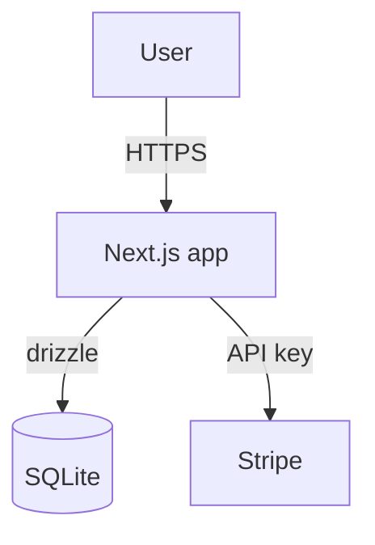

# Stage 2.5 + 2.6 + 2.7 — Tech Stack + Architecture + Coding Guidelines + Build Plan

> **POST-AUDIT AMENDMENTS (2026-04-29):** applied (changelog archived at `_archive/references/stage-amendments.md`). Operative deltas:
> - **2.5 produces `CODING_GUIDELINES.md`** in project repo (per D-S0.8). Stage 3.3 reformat + 3.4 codegen read this.
> - Per-choice rationale tied to project state (Claude composes ~500 tokens); override conflicts surfaced (e.g., 2.4 picked Vue components but framework defaulted Next → flag)
> - **Build plan (2.7):** topological sort + Claude review + parallel lanes + test gates per feature; deferred features logged with reason
> - **Verification (2.8):** 5-pass shape mirroring 1.9; **anti-gaslight bedrock check**: every component `picked=true` AND `asset_library_ref IS NOT NULL` (no override)
> - (Trivy-not-Snyk is in the body table; the "3 fixed Mermaid diagrams" line was superseded 2026-06-10 — see diagram section below)

Locks the build target so Stage 3 scaffolding has zero ambiguity.

## Tech stack defaults (R6.4)

Override only with reason. House defaults:

| Concern | Default | Override triggers |
|---|---|---|
| Framework | Next.js (App Router) | Mobile-only PWA → keep Next; native → Capacitor |
| Database | better-sqlite3 + drizzle-orm | Multi-writer concurrency → postgres + drizzle |
| Styling | Tailwind v4 + shadcn copy-paste | Designer wants raw CSS → CSS modules + tokens |
| Forms | react-hook-form + zod | (rarely overridden) |
| State | React Server Components first; client useState/Zustand for interaction | Heavy realtime → add socket.io client |
| Charts | Recharts | 3D / interactive viz → use d3 or react-flow |
| Tests | Vitest + Playwright | (Codex P1 #11: NEVER Snyk for security — Trivy/Grype/OSV-Scanner) |

Persist via `PUT /api/projects/<slug>/data-contracts` (database_engine, storage_location, migration_tooling) and a dedicated `tech_stacks` upsert when implemented.

## Architecture diagrams (Mermaid) — layer model (iter-16, 2026-06-11; supersedes the 2026-06-10 redesign)

Free, text-based, version-controllable. Author per the portfolio documentation layer model (Doc A/B/C + adr-017). The architecture page renders **stacked progressive sections in this order: Workflow → System → Platform → Decisions**, with the remaining kinds collapsed under "More detail".

### Which diagrams to author

- **Always (the 90-second read):**
  - **process** (rendered as **Workflow**) — how value moves, trigger → output. Max 12 nodes, top→bottom, verb-based labels, no infrastructure.
  - **topology** (rendered as **System**) — how the system is shaped: layers and relationships. Max 20 nodes; hide ports/containers/deployments.
- **Portfolio-level (one project carries it):**
  - **platform** — the ecosystem in one view: domains, data movement, build layer, external world. Currently attached to `portfolio`.
- **Only where they genuinely fit** (collapsed under "More detail" on the page):
  - **data** — sources → ingestion → DB tables → consumers
  - **ux** — a user journey complex enough to need a visual map
  - **api** — an external/public API surface worth diagramming

Curated decisions render below the diagrams automatically, grouped by category (iter-17): accepted, non-superseded `adr-index` rows carrying `cat:product` / `cat:system` / `cat:security` / `cat:reliability` show under recruiter-facing headings; `curated`-marked rows without a cat-tag stay hidden with a count line. Author every new ADR with a recruiter-readable title + `curated` + one cat-tag (or deliberately no cat-tag to hide). Rails (must_haves/non_goals/risks/verifier) stay hidden — adr-017/adr-018.

### Persist via the app (canonical)

Write each diagram via `POST /api/projects/<slug>/architecture` (bearer) with body `{kind, title, mermaid_src, caption}` (field is `mermaid_src`, not `mermaid_source` — verified against live API 2026-06-11). Per-kind upsert; the page fits diagrams to the viewport on render.



Keeping `.mmd` files in the project repo (`architecture/<diagram>.mmd`) is OPTIONAL — sources only; the DB rows are what the showcase displays.

## Build plan (R6.1 sub-stage 2.7)

Output: an ordered list of Stage 3 features to build. Format:

```
build_plan:
  - feature_id: feat-auth
    rationale: foundation; everything depends on user identity
    blocks: feat-checkout, feat-profile
  - feature_id: feat-product-list
    rationale: thin slice of value before checkout
    blocks: feat-cart
  ...
```

Persist as Stage-2-blob — no dedicated endpoint exists; attach to the project as an ADR (`POST /api/projects/<slug>/adr-index`, id `adr-NNN-build-plan-<slug>`). Per adr-014 the Stage 2→3 gate checks ADR-presence, nothing else — do not pretend a tech_stacks/build_plans row was written.

## Lock-in

Before exiting Stage 2.6: present the full tech stack + architecture diagrams + build plan as one consolidated panel. User confirms once. Trigger phrase: "let's scaffold" advances to Stage 3.
