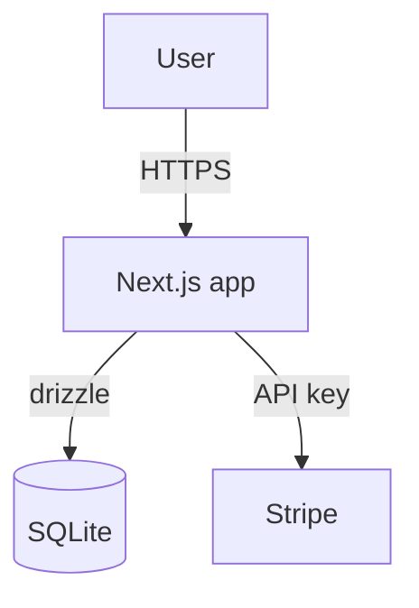

# Stage 2.5 + 2.6 + 2.7 — Tech Stack + Architecture + Coding Guidelines + Build Plan

> **POST-AUDIT AMENDMENTS (2026-04-29):** (applied; changelog archived at `_archive/references/stage-amendments.md`):
> - **NEW: 2.5 produces `CODING_GUIDELINES.md`** in project repo (per D-S0.8). Stage 3.3 reformat reads this; Stage 3.4 codegen reads this.
> - Trivy + Grype + OSV-Scanner (NOT Snyk per Codex P1 #11) — locked in nightly CI
> - Per-choice rationale tied to project state (Claude composes ~500 tokens)
> - Override conflicts surfaced (e.g., 2.4 picked Vue components but framework defaulted Next → flag)
> - 3 Mermaid diagrams: system-context / data-flow / auth-flow
> - **Build plan (2.7):** topological sort + Claude review + parallel lanes + test gates per feature; deferred features logged with reason
> - **Verification (2.8):** 5-pass shape mirroring 1.9; **anti-gaslight bedrock check**: every component `picked=true` AND `asset_library_ref IS NOT NULL` (no override)

Locks the build target so Stage 3 scaffolding has zero ambiguity.

## Tech stack defaults (R6.4)

Override only with reason. House defaults:

| Concern | Default | Override triggers |
|---|---|---|
| Framework | Next.js (App Router) | Mobile-only PWA → keep Next; native → Capacitor |
| Database | better-sqlite3 + drizzle-orm | Multi-writer concurrency → postgres + drizzle |
| Styling | Tailwind v4 + shadcn copy-paste | Designer wants raw CSS → CSS modules + tokens |
| Forms | react-hook-form + zod | (rarely overridden) |
| State | React Server Components first; client useState/Zustand for interaction | Heavy realtime → add socket.io client |
| Charts | Recharts | 3D / interactive viz → use d3 or react-flow |
| Tests | Vitest + Playwright | (Codex P1 #11: NEVER Snyk for security — Trivy/Grype/OSV-Scanner) |

Persist via `PUT /api/projects/<slug>/data-contracts` (database_engine, storage_location, migration_tooling) and a dedicated `tech_stacks` upsert when implemented.

## Architecture diagrams (Mermaid)

Free, text-based, version-controllable. Skill writes the source; mermaid-cli renders to SVG inside the project repo.

### Required diagrams

1. **System context** — boxes for the app, the user, every external service from Doc 7.third_party_services. Arrows label data flow.
2. **Data flow** — Doc 5.data_sources → ingestion → DB tables (Doc 5.contracts) → consumers (features). One arrow per source-to-table relationship.
3. **Auth flow** — Doc 7.auth_config strategy → session lifetime → per-page permission gates from Doc 4.

### Skill writes Mermaid source



Save as `architecture/<diagram>.mmd` in the project repo. mermaid-cli call:
```
npx -y @mermaid-js/mermaid-cli -i <diagram>.mmd -o <diagram>.svg
```
Stage 3 scaffolding adds the script to the repo's package.json.

## Build plan (R6.1 sub-stage 2.7)

Output: an ordered list of Stage 3 features to build. Format:

```
build_plan:
  - feature_id: feat-auth
    rationale: foundation; everything depends on user identity
    blocks: feat-checkout, feat-profile
  - feature_id: feat-product-list
    rationale: thin slice of value before checkout
    blocks: feat-cart
  ...
```

Persist as Stage-2-blob — no dedicated endpoint exists; attach to the project as an ADR (`POST /api/projects/<slug>/adr-index`, id `adr-NNN-build-plan-<slug>`). Per adr-014 the Stage 2→3 gate checks ADR-presence, nothing else — do not pretend a tech_stacks/build_plans row was written.

## Lock-in

Before exiting Stage 2.6: present the full tech stack + architecture diagrams + build plan as one consolidated panel. User confirms once. Trigger phrase: "let's scaffold" advances to Stage 3.
